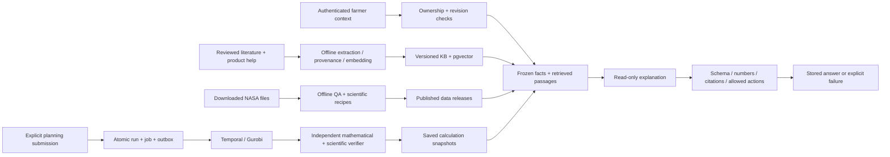

# Rotation v2 — local review and reproduction

Current integration branch: `integrated`; implementation baseline: `0271351`. See `BRANCHES.md` for the topic branches and their dependencies. This record supersedes the v1 worktree/location statements in `FIELD_SHIFT.md` for the new map, RAG and MILP routes. The original `/field-shift` and its saved analyses remain available. No deployment or push is part of this work.

**Review status:** core implementation and real runtime evidence exist. The AI semantic quality gate is HOLD. Both first protected evaluations scored 16/20 against the frozen 90% target; exposed-case regressions do not replace those scores. The last real v13 evaluation was interrupted by the OpenRouter key limit. Source candidate v15 adds source-faithful paraphrasing and conversational wording, but has no new generation results. Further paid calls have stopped pending available allowance. Do not describe this as production-ready agronomic advice or an independently validated model release. The configured default remains Nano; Mini is an evaluated candidate, not a silent default change.

## Farmer journey and ownership

Open `/field-shift/map`: choose a saved field separately from the map's query location; inspect dated NASA layers and missing-data reasons; open the floating Rotation assistant. `/field-shift/rotation` selects one or more owned fields, precise or explicitly imprecise previous-crop records, a horizon, crops, sowing windows, annual water/cost/labour limits, preferences, historical-weather scenarios and an independent baseline. Users explicitly calculate, compare, save, reopen and export. Chat does not perform those business writes.

Only Rotation is enabled. Water/soil and crop topics are prepared in the shared knowledge library, but no unfinished bot launcher is displayed. Desktop chat floats over the map; narrow screens use a bottom drawer. Source inspection retains message-specific facts and citations. Old replies are labelled with their original field/context, and stale navigation actions are disabled.

Map points, polygons and viewport selections are owner-scoped queries, not proof of land ownership. Saving a polygon as a field boundary requires an explicit action and does not overwrite the farmer's operating area. Invalid polygon submissions preserve editable vertices. Selected layer and observation date range are URL state. Unprepared area statistics are explicitly unavailable; a centroid reading is never presented as a polygon average.

## Code map

| Area | Main files | Responsibility |
|---|---|---|
| Pages | frontend `src/app/field-shift/{map,rotation}/page.tsx` | Separate operational entry points |
| Workspace | frontend `src/components/rotation/workspace.tsx`, `workspace-state.ts` | Owned data, URL context, dates, active result, pending state |
| Map | `map-canvas.tsx` | Leaflet, native science tiles, point/polygon/viewport, keyboard coordinate input |
| Assistant | `bot/Bot.tsx`, `bot/BotAnswer.tsx`, `rotation/assistant-dock.tsx` | Immediate user bubble, progressive validated reply, collapsed evidence, sources, history, preferences, recovery, owner remount |
| Planner/results | `planner-form.tsx`, `history-editor.tsx`, `results.tsx`, `planning-model.ts` | Editable constraints, no silent recompute, timelines, signed comparisons, snapshots |
| API client | frontend `src/lib/api/{rotation,rotation-types}.ts`, `client.ts` | Typed authenticated requests, aborts and binary tiles |
| `knowledge` | backend `modules/knowledge/{cli,ingest,store,retrieval,embeddings}.py` | Offline preparation, immutable KB releases, lexical/vector retrieval |
| `agri_data` | backend `modules/agri_data/{cli,service,recipes}.py`, `adapters/` | Published POWER/SMAP, QA, dates, native grids, facts |
| `rotation_optimizer` | backend `modules/rotation_optimizer/` | Versioned profiles, candidates, Gurobi, independent verification, jobs and saved plans |
| `farm_assistant` | backend `modules/farm_assistant/` | Owned frozen context, minimal model view, intent/retrieval, numeric binding, conversation persistence |
| Shared infrastructure | backend `modules/jobs/worker.py`, AI provider/settings, module registration | Generation-safe completion/leases and strict structured provider calls |

All backend module paths are under `sideronostos-backend/src/sideronostos_backend/`. Frontend component paths above share `sideronostos-frontend/src/components/rotation/`. Shared account/workspace features and v1 formulas were retained. Added v1 geometry/history fields preserve omitted values during old form updates.

## Read path, execution path and persistence



No online RAG request crawls the web, ingests documents or downloads new NASA data. Current account IDs come from authentication, not client input. Each message pins its KB release and context; shared vector caches contain public source embeddings only. Each run freezes full field versions, request, parameter profile and weather release. Idempotency keys reject reuse with different input. Cancellation/retry generations guard results and leases against late workers. A hard worker crash is recovered by Temporal activity retry with the same frozen input.

## Scientific scope

- POWER `power-iowa-2025-v1`: complete UTC 2025 daily minimum/maximum temperature, dewpoint, 2 m wind, shortwave radiation, pressure and corrected precipitation at 42 N, 93.5 W. Daily FAO-56 reference ET uses validated units; annual rain is 914.1 mm. This Iowa point is an engineering benchmark, not a chosen business pilot.
- SMAP `smap-20261107-v1`: SPL3SMP_E version 006, 2026-11-07, separate AM/PM native EASE-Grid cells. QA accepts retrieval flag 0/8, finite values in the documented supported range; unavailable values remain null. Grid spacing does not equal field-scale resolution. Single-day observations cannot establish trends or root-zone irrigation requirements.
- Profile `iowa-benchmark-20261112-v1`: maize/oat/pea; cited FAO crop coefficients and explicitly labelled benchmark phenology, resource, calendar and interval assumptions. Historical replay/scenarios remain distinct from observations and forecasts.
- Objective: weighted normalized growing coverage and family diversity, minus supplemental water and cost. Labour is a constraint. Supplemental water is a simplified daily gap with credited rainfall; there is no soil storage/runoff/drainage/irrigation-efficiency model, yield/profit predictor or local disease diagnosis.
- Candidate dates, path continuity, historic/all-pair family spacing, occupancy/turnaround and calendar-year shared resources are independently reconstructed. Optimality is only over generated candidates. An infeasible baseline does not prove optimizer-wide infeasibility. A feasible timeout is not proven optimal.
- Limits: up to 10 fields, 240 candidates and 1200 edges, explicit size rejection, bounded solver time. A working small Gurobi license was verified; arbitrary-size commercial entitlement is not implied.

## Setup and local services

Python 3.12, Node compatible with Next 16, pnpm 10.15, Docker, a PostgreSQL 16 pgvector extension, Temporal and a usable Gurobi license are needed. `uv.lock` and `pnpm-lock.yaml` retain all preexisting locked versions; added dependencies are separately locked.

From `sideronostos-backend`:

```sh
uv sync --locked --extra full
# Copy .env.example only for a new environment; preserve an existing .env.local.
uv run python -m alembic upgrade head
uv run uvicorn sideronostos_backend.app:app --host 127.0.0.1 --port 8040
# Separate terminals, same backend directory and configuration:
uv run python -m sideronostos_backend.modules.temporal.worker
uv run python -m sideronostos_backend.modules.jobs.dispatcher
```

The current local stack uses API 8040, frontend 3040, PostgreSQL 55439 (`field_shift`), Temporal 7249 / UI 8249, Mailpit SMTP 1049 / UI 8049 and Minio 9049 / 9149. Namespace and task queue are `field-shift-dev`. Preserve existing volumes and configured ports; `infra-reset` is destructive and is not a reproduction prerequisite. Migrations 0013–0016 add knowledge, science, optimizer and assistant tables after existing v1 migration 0012. A pre-change database backup and restore verification are recorded locally.

From `sideronostos-frontend`:

```sh
corepack pnpm@10.15.0 install --frozen-lockfile
# .env.local: NEXT_PUBLIC_API_BASE_URL=http://localhost:8040
corepack pnpm@10.15.0 build
corepack pnpm@10.15.0 start --hostname 127.0.0.1 --port 3040
```

Use `http://localhost:3040` consistently in browser, CORS and auth origin settings. Keep OpenRouter credentials exclusively in ignored backend `.env.local` (mode 600), never `NEXT_PUBLIC_*`. Configure `AI_BASE_URL=https://openrouter.ai/api/v1`, the assistant task model, low reasoning, omit temperature, 4000 tokens, 30 s provider timeout, no transport retries, strict parameter support; see `.env.example`. The entire message deadline is 45 s, including at most one validation repair. Embedding uses `openai/text-embedding-3-small`, 1536 dimensions. Empty embedding-specific key/base inherit the chat provider. Model changes do not change embeddings; embedding changes require a new namespace/release.

## Rebuild knowledge and science

Raw assets, embeddings, releases and private backups live in ignored root `data/`; they are not fabricated by startup. Source manifest `modules/knowledge/data/library-manifest.json` contains source URLs, exact reader paths/hashes, scope, exclusions, page anchors and reviewed claims. The original literature is at:

`/Users/fanysmacpro/Documents/Graduate_learning/NASAappChallenge/field_shift_lit_review_202610110835/Literature Review`

Provide those exact source reader copies to reproduce the existing release. Re-downloaded pages can differ: review them and issue a new release rather than bypassing hashes. Prepared assets require the SMAP006 user guide and the versioned product-help copy named in the manifest. Product help is checked into `modules/knowledge/data/readers/product-help-v2.md`; the original downloaded PDFs remain outside Git.

From backend, after preparing the matching files under `../data/knowledge/sources`:

```sh
make prepare-knowledge ARGS='prepare --library-root "/absolute/path/to/Literature Review" --bundle ../data/knowledge/prepared-v4.json'
make prepare-knowledge ARGS='stage --bundle ../data/knowledge/prepared-v4.json --release field-shift-knowledge-20261113-v4'
make prepare-knowledge ARGS='embed --release field-shift-knowledge-20261113-v4'
make prepare-knowledge ARGS='activate --release field-shift-knowledge-20261113-v4'
```

Embedding is a paid external operation; staging and activation are explicit. Existing published IDs are immutable. Old conversations retain old releases. The current active release has 44 source records (43 included), 4878 chunks and 22 reviewed claims, manifest SHA256 `dcdf044abd636198239a1a8793de2a5301a513548ed640a3e58750741f906757`. Extraction marks unreadable PDF glyphs; those damaged formulas/numbers are not executable parameters.

POWER capture request and raw hash are in `output/evidence/rotation-v2/power-capture.json`. It requests seven variables, community AG, UTC, 20250101–20251231, latitude 42, longitude -93.5. Its preserved response is `data/raw/power/iowa-benchmark-2025.json`.

```sh
make prepare-data ARGS='publish-power --source ../data/raw/power/iowa-benchmark-2025.json --release power-iowa-2025-v1 --latitude 42 --longitude -93.5 --start 2025-01-01 --end 2025-12-31'
make prepare-data ARGS='prepare-smap --source "/absolute/path/SMAP_L3_SM_P_E_20261107_R19240_001.h5" --output ../data/staging/smap-20261107'
make prepare-data ARGS='publish-smap --source ../data/staging/smap-20261107 --release smap-20261107-v1'
```

Science manifest hashes: POWER `c0b7ba19c3630bf4247eccf76ef8a3ffc63b27f755da82331828d6cceb3cdec6`; SMAP `fa84e0f08b30da13fda6effc40d4e52aee591b5dfd43a95ff527dbb3b8479bc7`. Publication validates identity/content; changing assets requires a new release and compatible profile reference.

## Verification and evidence

Backend `make check-optimizer` uses real Gurobi and independent small-instance oracles. `make check-rotation` performs non-mutating lint/type/test checks for new modules. Set `FIELD_SHIFT_TEST_DATABASE_URL` to a dedicated test database to enable persistence tests; their fixtures reset tables. **Never point it at the main application database.** Latest full backend suite: 338 passing (including the dedicated real PostgreSQL tests). Frontend full suite: 200 passing, TypeScript and production build passing. Under Node 26 use `NODE_OPTIONS=--no-experimental-webstorage` for jsdom tests.

Whole-repository backend mypy has seven preexisting errors in unchanged `ai/graph.py` and `ai/gradio_console.py`; this is not a clean whole-repository typing claim. Scoped new-module typing passes. Existing PDF bindings emit deprecation warnings. Browser evidence includes expected auth refresh/404/422 responses and benign Next CSS preload warnings; old dev-server reconnect messages are not production errors.

Frozen 60-case AI suite is at `farm_assistant/evaluation/cases-v1.json`, SHA256 `41985bfa558fb7a58108b44bd0440e050c7d3d5b5ebc4888acf7ae1fec7a6134`. Evaluation records source hashes, model/config, KB identity, costs including repairs, delays and every attempt. Controlled failure fixtures are labelled; normal optimizer fixtures use real weather/solver and synthetic owned fields. The original v1 fixture is preserved; v2 corrects the controlled timeout status spelling only.

```sh
make eval-assistant ARGS='--split dev --fixtures ../output/evidence/rotation-v2/eval-fixtures-v2-status.json --output ../output/evidence/rotation-v2/a-new-report.json'
# A protected run requires a completed review artifact; do not overwrite old reports.
# Optional candidate override for a paid comparison:
# AI_TASK_CONFIGS__FARM_ASSISTANT__MODEL=openai/gpt-5.4-mini make eval-assistant ARGS='...'
```

Raw evaluation output is local review evidence, not a distributable literature corpus. `output/evidence/rotation-v2` contains snapshots, source/solver checks, API owner isolation, active cancellation and worker-crash recovery. `output/playwright` contains map/chat, mobile, comparison and saved-plan screenshots/video. The research evidence ledger and detailed model comparison remain under the user's `NASAappChallenge/docs` folder. See `output/evidence/rotation-v2/REVIEW.md` for the current evidence inventory and unresolved gates. Latest deterministic checks are pinned in `verification-v5-20261113.json`; the original verification records remain historical.

## Remaining limitations and release decision

The system is a local engineering benchmark with real retrieved documents, satellite data and optimization, not a calibrated pilot. Region-specific retrieval applicability is supplied as source metadata and answer qualifications; automatic pilot-region filtering is not implemented because the pilot is unchosen. The current local help source URL may not resolve on the remote branch until separately published. HLS/L4/ECOSTRESS/soil-test numerical products have not been ingested. No synthetic replacement is supplied when a release, key, license or observation is unavailable.

A future production decision requires final model selection, fresh independent semantic evaluation of the frozen final pipeline, local agricultural calibration, real farmer usability feedback, and deployment-specific operations/load review. This repository work does not authorize a deployment or promise those outcomes.

## Conversational presentation (2026-11-13)

Replies appear as plain chat paragraphs. Evidence and captured facts sit behind “依据与数据”; navigation actions retain their context guards. The user message appears immediately and the composer clears before the HTTP call resolves. The submitted context is frozen at the click. New validated replies reveal progressively, with a show-all control; history and reduced-motion preference render in full. Reading older messages disables automatic following. Account/conversation changes and closing the panel clean up the presentation. Screen readers receive one complete-response announcement, not character updates.

This is client presentation after server validation, **not live provider token streaming**; it does not reduce model latency. Raw unchecked text is never released to the page. No endpoint, retrieval path, database schema, numeric binding, ownership rule or model default changed. See `conversational-chat-20261113.json` for the exact stored-response replay and its limits. Prompt v15 asks for everyday direct answers without report headings unless requested; new wording is not yet measured. The existing API process remains v13 until deliberately restarted for a future authorized real evaluation.

## Reusable bot and selected-area full screen (2026-11-13)

`grok_bot` contains only the generic React bot surfaces, styles, tests and standalone TS contracts. It does not require the RAG backend. `components/bot/README.md` describes slots and caller responsibilities. The integrated workspace supplies conversation transport and selected-area data through the Rotation adapter.

The bot has collapsed, floating-chat and full-screen-data modes. Selection enables the full-screen control; switching preserves the draft and message DOM. Escape returns to chat, then to the launcher. Native modal focus confinement applies only to full-screen data. The map remains mounted behind it. Clearing selection disables data mode.

The data view shows selection geometry metadata, requested dates, actual prepared facts, quality/missing states and expandable sources. A reading of zero remains zero; absent values remain missing. Data from a previous selection/revision is not shown. There is still no prepared polygon aggregate: selected polygons show their geometry area and the explicit missing-statistics state, never centroid values presented as area averages.

Branch exports were independently checked for module registration, migration heads and relevant offline tests. The standalone bot passes its tests, TypeScript and an isolated Webpack production build (the temporary export shares node_modules, which Turbopack does not allow outside its root). The integrated Turbopack production build passes. Browser verification covers desktop 1440×900, mobile 390×844, focus, Escape, drafts, selected point, selected area and clearing selection. Local evidence: `output/evidence/rotation-v2/branch-split-fullscreen-20261113.json`. No paid inference or embedding call was made for this change.
