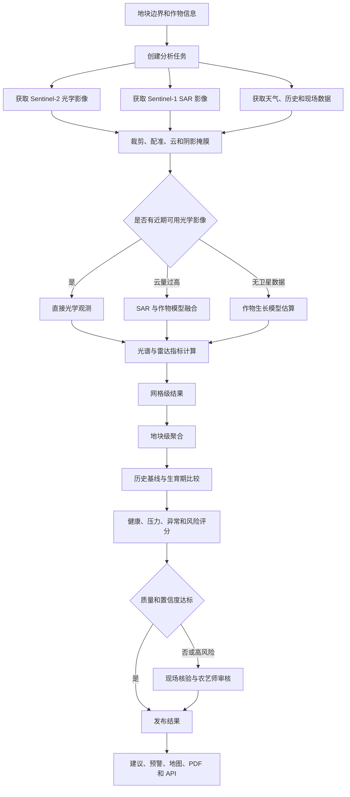
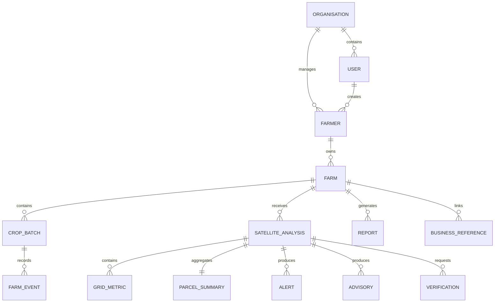
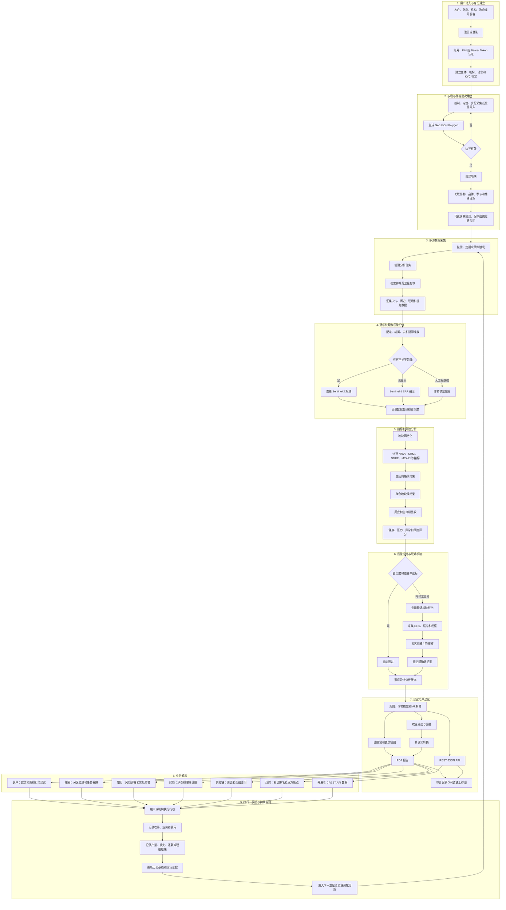

# FarmHawk 系统信息汇总与分析

> 分析对象：[FarmHawk](https://farmhawk.ai/#how-it-works)  
> 整理日期：2026-11-09  
> 分析范围：官网、平台与行业解决方案页面、开发者页面及公开 Web 应用前端

## 1. 文档说明

FarmHawk 未公开完整的数据库表结构、OpenAPI 文档、模型技术白皮书或全部上游数据供应商。因此，本文将信息分为以下两类：

- **官方明确披露**：官网、博客、平台页或行业解决方案页面直接说明的信息。
- **公开前端推断**：从公开 Web 应用的字段名、界面文案和接口调用中还原的逻辑结构，不代表真实后台数据库 DDL 或正式 API 契约。

## 2. 系统概述

FarmHawk 是一个以地块为核心的农业遥感与业务决策平台。系统将地块边界、作物批次、卫星时序、天气、现场核验和金融/保险业务记录组织成可持续更新的“农场记录”。

其基本工作方式为：

1. 用户在地图上绘制地块，或使用 GPS 沿地块边界采集顶点。
2. 系统获取覆盖地块的 Sentinel 卫星影像及其他辅助数据。
3. 系统计算植被、水分、叶绿素、环境压力等遥感指标。
4. 结合历史基线、作物类型、生育期和天气信息形成健康及风险评分。
5. 对低置信度或高风险结果发起现场核验。
6. 输出健康地图、农业建议、预警、PDF 报告和 REST API 数据。
7. 将用户行动、产量、理赔等结果回流，进入下一监测周期。

主要应用对象包括：

- 农户和农场主；
- 外勤人员和农艺师；
- 农业信贷机构；
- 农业保险机构；
- 农产品供应链企业；
- 政府和发展机构；
- 大型庄园和种植园；
- 第三方农业科技开发者。

## 3. 数据来源

| 数据类别 | 数据来源 | 主要内容 | 确认程度 |
| --- | --- | --- | --- |
| 光学遥感 | Sentinel-2 | 可见光、近红外、短波红外多光谱影像，约 5 天重访 | 官方明确 |
| 雷达遥感 | Sentinel-1 SAR | 云覆盖时补充观测，用于湿度和变化估计 | 官方明确 |
| 地块数据 | 农户、外勤人员或机构 | 地块边界、GPS 顶点、面积、中心点、地块名称 | 官方明确 |
| 农业生产数据 | 农户或机构申报 | 作物、品种、季节、播种日期、种植方式、农事活动 | 官方及前端明确 |
| 天气数据 | 未披露的第三方或内部服务 | 天气暴露、降雨、干旱、温度等风险因素 | 使用已确认，供应商未披露 |
| 历史遥感数据 | 平台历次分析 | 多季光谱时序、历史健康表现、异常基线 | 官方明确 |
| 现场核验数据 | 外勤人员、农户和农艺师 | GPS、照片、症状、严重程度、核验结论 | 公开前端明确 |
| 金融与保险数据 | 合作机构 | 贷款元数据、保单、理赔事件、借款人关联信息 | 行业页面明确 |
| 行政区划数据 | 政府或机构导入 | 国家、州、区、街区、村庄和自定义区域边界 | 官方明确 |
| IoT 数据 | 可选平台能力 | 官网将 IoT 列入共享技术栈，但基础监测无需硬件 | 是否接入因项目而异 |
| 区块链数据 | Polygon 等链上凭证 | 地块或农事事件的哈希、交易编号、时间戳 | 前端和解决方案页面可见 |
| Landsat | 前端传感器枚举 | 可能作为兼容或备用影像来源 | 仅前端线索，未确认生产使用 |

### 3.1 数据来源限制

- 官网没有说明 Sentinel 数据是直接来自 Copernicus Data Space，还是经 Google Earth Engine、AWS、Sentinel Hub 等中间服务获取。
- 天气数据的具体供应商、时间分辨率和空间分辨率没有公开。
- 前端存在 Landsat 传感器枚举，但不足以证明生产环境正在使用 Landsat。
- 官网将 IoT 列为平台技术之一，但同时强调基础遥感监测不需要传感器、无人机或现场硬件。

## 4. 地块几何规范

系统使用 **任意不规则闭合多边形** 表示农业地块，对应 GeoJSON `Polygon`。

### 4.1 已确认约束

- 至少需要 3 个角点。
- 首尾坐标必须闭合，构成一个线性环。
- 地块边界不能自相交。
- 坐标采用 WGS84，经度在前、纬度在后：`[longitude, latitude]`。
- 当前公开分析错误信息明确要求 `Polygon`。
- 未确认分析接口是否支持 `MultiPolygon`。
- 绘图界面主要生成单一外边界，尚不能确认是否支持内部孔洞。

### 4.2 地块录入方式

- 在卫星地图上依次点击地块角点；
- 沿地块边界行走，在每个角点采集 GPS；
- 机构批量导入已有地块或行政区域边界；
- 放置定位点用于找到地块位置，但最终分析仍需要多边形边界。

### 4.3 GeoJSON 示例

```json
{
  "type": "Polygon",
  "coordinates": [[
    [103.8510, 1.2900],
    [103.8530, 1.2905],
    [103.8525, 1.2920],
    [103.8505, 1.2915],
    [103.8510, 1.2900]
  ]]
}
```

## 5. 数据处理链路



### 5.1 数据产生方式

公开前端区分以下数据来源类型：

- `optical`：近期光学卫星直接观测；
- `sar`：雷达数据估算；
- `hybrid`：光学、雷达、天气和模型融合；
- `model`：没有可用卫星数据时的作物模型估计。

公开前端还存在以下融合方法枚举：

- `direct_optical`；
- `sar_moisture_fusion`；
- `sar_optical_hybrid`；
- `optical_persistence`；
- `growth_model_projection`。

因此，系统输出必须保留以下质量元数据：

- 传感器名称；
- 影像日期；
- 云覆盖率；
- 数据来源类型；
- 融合方法；
- 置信度；
- 掩膜或缺失网格数量；
- 结果是直接观测还是模型估算。

## 6. 核心指标

| 指标 | 含义 | 主要用途 |
| --- | --- | --- |
| NDVI | 归一化植被指数 | 植被密度和总体健康 |
| NDMI | 归一化水分指数 | 冠层水分和水分胁迫代理 |
| NDRE | 红边归一化指数 | 叶绿素和氮素状态代理 |
| CI Red Edge | 红边叶绿素指数 | 叶绿素状态 |
| MCARI | 改进型叶绿素吸收反射指数 | 叶绿素和营养胁迫 |
| EVI | 增强植被指数 | 高覆盖植被状态 |
| GNDVI | 绿色归一化植被指数 | 叶绿素和植被活力 |
| LSWI | 地表水分指数 | 地表与植被水分状态 |
| LST | 地表温度 | 热胁迫和环境条件 |
| ND-SAR | 雷达植被指数 | 雷达条件下的植被变化 |
| Backscatter Difference | 雷达后向散射变化 | 水分或结构变化检测 |
| Abiotic Stress | 非生物胁迫指数 | 干旱、热、盐分等环境压力 |
| Biotic Stress Probability | 生物胁迫概率 | 病虫害风险筛查 |

### 6.1 指标解释注意事项

- NDMI 更接近冠层或植被水分代理，不应直接等同于地面传感器测得的土壤体积含水率。
- 病虫害风险是光谱异常推断，不能替代对具体病原体或害虫的现场诊断。
- N、P、K、pH 和微量元素等结果属于卫星派生估计，精确施肥或合规检测仍需实验室土壤检测。
- 雷达或模型代理值的可信度通常低于无云光学直接观测。

## 7. 逻辑数据结构

### 7.1 实体关系



### 7.2 Farmer 农户

```json
{
  "id": "uuid",
  "first_name": "string",
  "last_name": "string",
  "email": "string",
  "mobile_number": "string",
  "gender": "string",
  "village": "string",
  "primary_crop": "string",
  "preferred_language": "string",
  "kyc_status": "PENDING|VERIFIED",
  "geo_status": "NOT_MAPPED|MAPPED",
  "organisation_id": "uuid",
  "photo_base64": "string"
}
```

### 7.3 Farm / Parcel 地块

```json
{
  "id": "uuid",
  "farmer_id": "uuid",
  "name": "string",
  "boundary_geojson": {
    "type": "Polygon",
    "coordinates": []
  },
  "total_area_acres": 2.35,
  "total_area_hectares": 0.95,
  "crop_id": "string",
  "country_code": "IN",
  "verification_status": "PENDING|VERIFIED",
  "created_at": "datetime"
}
```

### 7.4 CropBatch 种植批次

```json
{
  "id": "uuid",
  "farm_id": "uuid",
  "farmer_id": "uuid",
  "crop_code": "RICE",
  "crop_variety": "string",
  "season": "Kharif 2026",
  "sowing_date": "date",
  "farming_practice": "ORGANIC|CONVENTIONAL|MIXED",
  "area_acres": 2.35,
  "country_code": "IN",
  "status": "ACTIVE|HARVESTED"
}
```

### 7.5 FarmEvent 农事事件

```json
{
  "id": "uuid",
  "batch_id": "uuid",
  "event_code": "FERTILIZER_APPLICATION",
  "event_date": "datetime",
  "quantity": 50,
  "unit": "kg",
  "cost": 120,
  "currency": "INR",
  "gps_lat": 12.345,
  "gps_lng": 77.123,
  "gps_accuracy_m": 8,
  "photo_base64": "string",
  "extra_data": {
    "npk_ratio": "20:20:20",
    "application_method": "Broadcasting"
  }
}
```

农事事件类型包括但不限于：

- 土壤准备；
- 播种；
- 灌溉；
- 化肥或有机肥施用；
- 病虫害防治；
- 巡田和观察；
- 收获和产量记录；
- 批次关闭、转移和二维码追溯。

### 7.6 SatelliteAnalysis 遥感分析

```json
{
  "id": "uuid",
  "farm_id": "uuid",
  "batch_id": "uuid",
  "observation_date": "date",
  "sensor": "Sentinel-2|Sentinel-1|Landsat",
  "data_source": "optical|sar|hybrid|model",
  "fusion_method": "direct_optical|sar_optical_hybrid",
  "cloud_cover_pct": 12.4,
  "confidence_score": 0.86,
  "growth_stage": "TILLERING",
  "mean_ndvi": 0.62,
  "mean_ndmi": 0.31,
  "mean_ndre": 0.27,
  "mean_mcari": 0.18,
  "severity_index": 0.22,
  "masked_points": 4,
  "status": "COMPLETED",
  "created_at": "datetime"
}
```

### 7.7 GridMetric 网格指标

```json
{
  "analysis_id": "uuid",
  "grid_id": "string",
  "geometry": {
    "type": "Point",
    "coordinates": [77.1, 12.3]
  },
  "ndvi": 0.64,
  "ndmi": 0.28,
  "ndre": 0.24,
  "mcari": 0.17,
  "abiotic_stress": 0.2,
  "biotic_stress_probability": 0.12,
  "quality_flag": "VALID|CLOUD|SHADOW|MODELLED"
}
```

### 7.8 Alert / Advisory 预警与建议

```json
{
  "analysis_id": "uuid",
  "metric": "NDMI",
  "risk_level": "LOW|MODERATE|HIGH|CRITICAL",
  "headline": "Moderate moisture deficit",
  "summary": "string",
  "cause": "string",
  "action": "string",
  "treatment": "string",
  "timing": "string",
  "dosage": "string",
  "estimated_cost": "string",
  "confidence": "string",
  "language": "en"
}
```

## 8. 完整业务流程



## 9. 面向不同业务场景的输出

### 9.1 农户

- 地块健康地图；
- NDVI、NDMI 等指标；
- 灌溉、施肥、病虫害巡查和收获建议；
- 作物生育期和异常预警；
- 多语言页面、音频或 PDF 报告。

### 9.2 大型农场与庄园

- 地块和分区级监测；
- 压力热点；
- 跨地块趋势对比；
- 现场巡查任务安排；
- 管理者仪表盘。

### 9.3 银行与农业信贷

- 借款人地块关联；
- 地块级风险评分；
- 作物健康和天气暴露；
- 贷后持续监测；
- 压力、干旱和异常阈值预警；
- 审计轨迹或链上证明。

### 9.4 农业保险

- 地块核验；
- 承保风险定价；
- 损失事件检测；
- 事故前、中、后的光谱历史；
- 卫星、天气和现场证据包；
- 理赔辅助审核。

### 9.5 供应链

- 地块地理定位；
- 作物批次与农事事件；
- 收获、转移和二维码追溯；
- 合规与来源证明；
- 地块或事件哈希存证。

### 9.6 政府和发展机构

- 行政区和村级作物识别；
- 作物结构和季节变化；
- 村级健康、压力和生产力评分；
- 村庄排名和区域热点；
- 补贴、投入品和推广资源配置支持。

### 9.7 开发者 API

开发者页面明确说明：

- 使用 REST API；
- 使用 Bearer Token 鉴权；
- 返回结构化 JSON；
- 提供地块健康、风险评分、作物识别、历史光谱时序和村级信息；
- 支持 Sandbox 和按调用量计费。

公开站点未提供可匿名访问的正式 OpenAPI Schema，本文示例不能直接作为生产接口契约。

## 10. 数据质量与治理风险

### 10.1 数据质量

1. 云覆盖时可能使用 SAR 或模型补值，必须区分直接观测与估算结果。
2. 公开前端提示 SAR 代理出的 NDVI/NDMI 准确度可能约为 55%，不应与无云光学结果等同使用。
3. 低置信度和高风险结果需要现场核验。
4. 病虫害风险是筛查结果，不是病原体确诊。
5. 土壤养分和 pH 是遥感代理，不能替代实验室检测。
6. 不同时间影像的云量、作物阶段和数据来源不同，趋势分析必须使用质量标记。

### 10.2 隐私与权限

系统可能处理以下敏感数据：

- 农户身份和联系方式；
- KYC 状态；
- 精确地块边界和 GPS；
- 现场照片；
- 贷款、保单和理赔数据；
- 生产成本、产量和交易记录。

建议按农户、外勤人员、机构管理员、审核人员和 API 客户端实施最小权限控制，并对不同数据设置保存期限。

### 10.3 区块链使用边界

区块链适合保存：

- 记录哈希；
- 时间戳；
- 交易编号；
- 版本或签名证明。

不宜直接将以下内容写入公共链：

- 农户个人身份信息；
- 完整地块 GeoJSON；
- GPS 轨迹；
- 现场照片；
- 贷款和保单明细。

### 10.4 采购和集成前需要确认

- 卫星数据的实际采购或访问渠道；
- 天气数据供应商及其空间/时间分辨率；
- 正式 API Schema 和版本策略；
- 支持的 GeoJSON 类型和坐标系；
- 模型训练数据、地面真值和各作物验证指标；
- 数据驻留、保留、删除和导出政策；
- 自动评分在信贷和理赔中的人工复核机制；
- 区块链网络、上链字段和撤销/纠错方案。

## 11. 推荐的技术存储形态

根据公开功能，合理的技术架构可能包括：

- **关系数据库**：组织、用户、农户、地块、批次、事件、贷款和保单关系；
- **空间数据库**：地块 Polygon、行政区、分析网格和空间查询；
- **时序或分析存储**：历次光谱指标、天气和评分；
- **对象存储**：卫星裁剪结果、地图、照片、PDF 和证据包；
- **任务队列**：卫星处理、报告生成、周期调度和现场核验；
- **审计与链上凭证**：记录版本、哈希、时间戳和交易编号。

以上是根据产品行为推导的合理架构，不代表 FarmHawk 已公开其真实部署方案。

## 12. 结论

FarmHawk 的核心数据对象是 `Farm / Parcel`。系统以 GeoJSON Polygon 地块为时空主键，将作物批次、Sentinel 遥感时序、天气、现场核验以及金融和保险记录组合为一个持续更新的农场记录。

其核心价值不只是展示卫星图，而是完成以下闭环：

```text
地块建档
  → 多源观测
  → 数据质量分流
  → 指标与风险分析
  → 人工核验
  → 建议、报告和 API
  → 用户或机构执行
  → 现场与业务结果回流
  → 下一周期持续监测
```

在高影响场景中，特别是授信、拒贷、承保、拒赔和补贴分配，模型输出不应单独作为最终决策依据。应同时检查数据来源、影像日期、云覆盖、融合方法、置信度、历史基线和现场核验结果。

## 13. 参考页面

- [FarmHawk - How it works](https://farmhawk.ai/#how-it-works)
- [FarmHawk Platform](https://farmhawk.ai/platform)
- [How satellite crop monitoring works](https://farmhawk.ai/blog/how-satellite-crop-monitoring-works)
- [What is NDVI?](https://farmhawk.ai/blog/what-is-ndvi)
- [FarmHawk APIs](https://farmhawk.ai/solutions/developers)
- [FarmHawk deRISK - Lenders](https://farmhawk.ai/solutions/lenders)
- [FarmHawk Umbra - Insurers](https://farmhawk.ai/solutions/insurers)
- [FarmHawk VUE - Government](https://farmhawk.ai/solutions/government)
- [FarmHawk Estates](https://farmhawk.ai/solutions/estates)
- [FarmHawk Supply Chain](https://farmhawk.ai/solutions/supply-chain)

